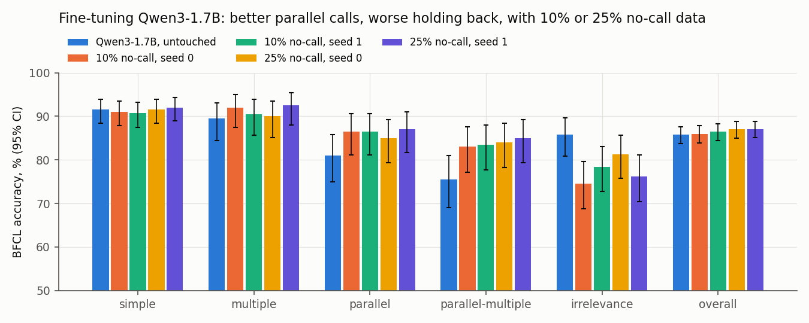

```
  _       _                       _
 | |_ _ _(_)__ _ __ _ ___ _ _ ___| |_  __ _ _ __ _ __ _  _
 |  _| '_| / _` / _` / -_) '_|___| ' \/ _` | '_ \ '_ \ || |
  \__|_| |_\__, \__, \___|_|     |_||_\__,_| .__/ .__/\_, |
           |___/|___/                      |_|  |_|   |__/
```

I fine-tuned Qwen3-1.7B for tool calling on a 6 GB laptop GPU. It got better at making several calls at once, and worse at *not* calling. Then I looked inside it to find out why, and tried two fixes. Week 08 of a weekly AI deep dive.

**Full write-up: [REPORT.md](REPORT.md)** | **Adapter on Hugging Face: [vinnvinn/trigger-happy-qwen3-1.7b-lora](https://huggingface.co/vinnvinn/trigger-happy-qwen3-1.7b-lora)**



## Findings

**\o/ Better at multi-call requests.** On BFCL parallel-multiple, accuracy went from 75.5% to 83-85% in all four fine-tuned runs (p <= 0.011 each).

**o_O Worse at holding back.** When no tool fits, it calls one anyway more often: irrelevance accuracy fell from 85.8% to 74.6-81.2%. Asked "Who won the NBA MVP in 2020?" with only a player-stats tool available, the untouched model just answers. The fine-tuned one calls the tool for LeBron James. The overall score barely moves, because the gain and the loss cancel out.

**-_- It knows, and it calls anyway.** On prompts where no tool fits, the fine-tuned model is visibly less sure about calling: its own probability of starting a call separates "no tool fits" from "a tool fits" with AUROC 0.94-0.96. It just isn't less sure enough. The problem is the decision, not the knowledge.

**:( Neither fix worked.**
- More "don't call" training data (25% instead of 10%): seed 0 looked like it fixed half the gap. Seed 1 didn't repeat it.
- Steering toward "no tool fits": it cut over-calling on real users' messages, but it also refused real users who did need a tool, about 19 points more often either way.

Both fixes looked good on their first test and failed a better-matched one. `CLAIMS.md` records each check.

## Setup

| | |
|---|---|
| Model | Qwen3-1.7B, bf16 base, LoRA rank 16 on all linear layers (17.4 M trainable) |
| Data | 8,000 xLAM calls + 10% or 25% xlam-irrelevance "don't call" examples |
| Hardware | RTX 3050 laptop, 6 GB; peak 4.58 GB; about 4 h per run |
| Evaluation | BFCL single-turn (1,240 prompts), own scorer, paired McNemar tests |

## Run it

```
pip install -r requirements.txt --extra-index-url https://download.pytorch.org/whl/cu124
python src/data.py
python src/train.py --model Qwen/Qwen3-1.7B --nocall-share 0.1 --seed 0
python src/evaluate.py --model Qwen/Qwen3-1.7B --adapter adapters/Qwen3-1.7B_n8000_nocall0.1_r16_s0
```

The probe and steering commands are in [REPORT.md](REPORT.md#reproduce). xLAM is gated on Hugging Face, so accept its terms first.

## Files

- `src/`: data, training, evaluation, activations, probes, steering, plots
- `results/`: every model output (one line per prompt), plus `figures/`
- `REPORT.md`: the full write-up
- `CLAIMS.md`: headline claims and the checks run on them
- `PLAN.md`: the plan, with dated notes
- `MODEL_CARD.md`: the Hugging Face model card for the released adapter ([vinnvinn/trigger-happy-qwen3-1.7b-lora](https://huggingface.co/vinnvinn/trigger-happy-qwen3-1.7b-lora))

Licences: Qwen3 Apache-2.0; xLAM and xlam-irrelevance CC-BY-4.0; BFCL Apache-2.0 (evaluation only).
