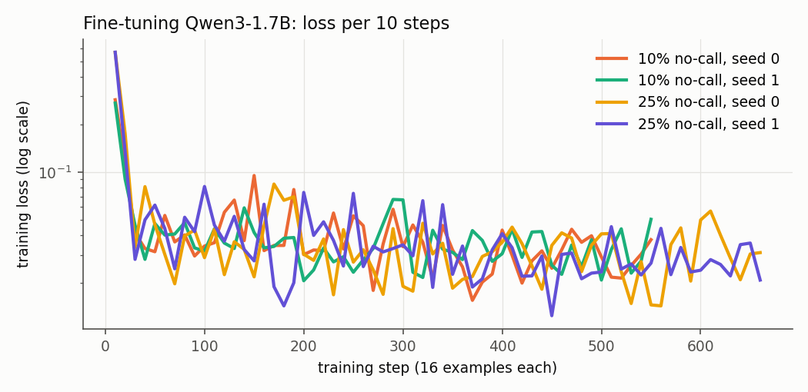
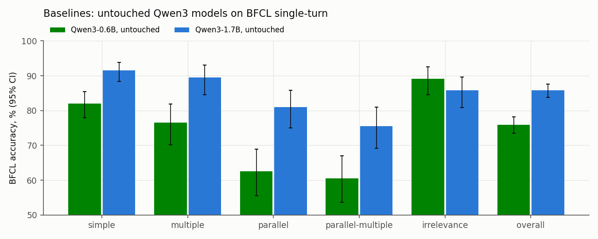
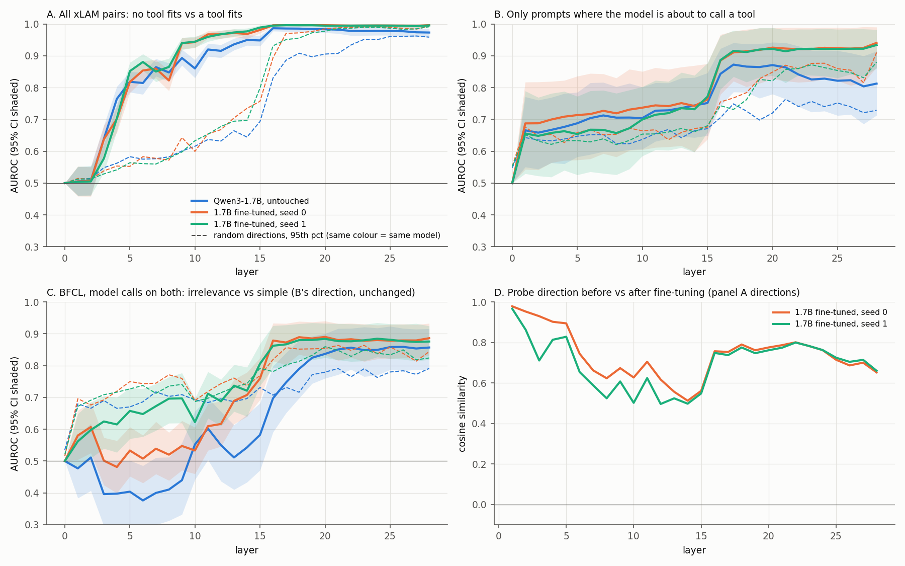
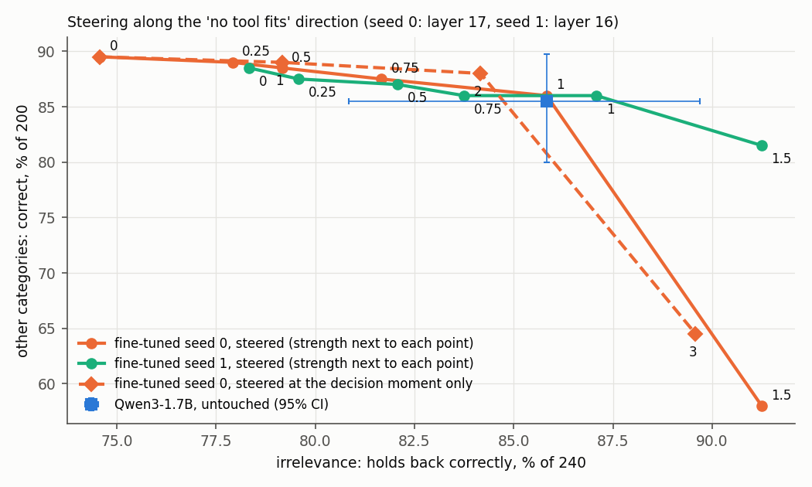
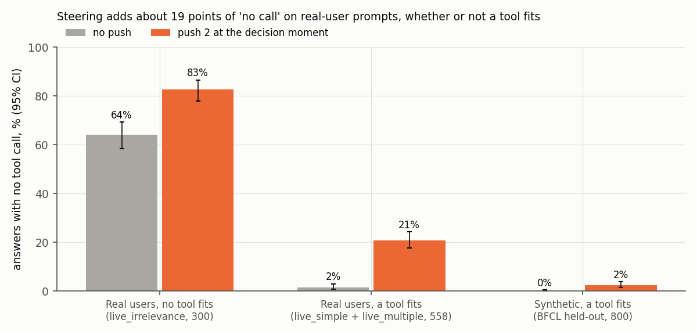

# It knows, and it calls anyway: fine-tuning a small model for tool calling

*Qwen3-1.7B on a 6 GB laptop GPU. Adapter: [vinnvinn/trigger-happy-qwen3-1.7b-lora](https://huggingface.co/vinnvinn/trigger-happy-qwen3-1.7b-lora).*

## Abstract

I fine-tuned Qwen3-1.7B with LoRA on 8,000 tool-calling examples and scored it on the Berkeley Function Calling Leaderboard (BFCL). In all four fine-tuned runs, it got better at requests that need several calls (parallel-multiple: 75.5% to 83-85%). It also got worse at holding back when no tool fits (irrelevance: 85.8% to 74.6-81.2%).

When it makes one of those unneeded calls, the model still "knows" no tool fits: it is visibly less sure about calling, and the call wins anyway.

Two fixes failed:
- More "don't call" training data had no effect I could detect across two seeds.
- Steering toward "no tool fits" made the model refuse real users more often, whether or not a tool fit.

Both looked good on their first test and failed a better-matched one.

## 1. Questions

1. Does a cheap LoRA fine-tune help a 1.7B model on a standard benchmark, and what does it cost?
2. When the fine-tuned model calls a tool it shouldn't, has it lost the ability to tell, or does it know and call anyway?
3. If it knows, can we use that to fix it?

**Terms:**
- **LoRA** trains a small set of extra weights (here 17.4 M, about 1% of the model) on top of a frozen model.
- **BFCL** is a public benchmark with five single-turn categories:
  - **simple:** one tool, one call.
  - **multiple:** several tools, one fits.
  - **parallel:** the same tool, several calls.
  - **parallel-multiple:** several tools, several calls.
  - **irrelevance:** no tool fits, so the right answer is no call.
- **A probe** is the average difference between two groups of hidden states at one layer. Each prompt gets a score along it.
- **AUROC** is how often a score ranks a random member of one group above a random member of the other: 0.5 is chance, 1.0 is perfect.
- **Steering** adds a direction to the hidden state while the model generates, to see what it causes.

## 2. Setup

| | |
|---|---|
| Model | Qwen3-1.7B, bf16 base (not 4-bit), thinking off, greedy decoding |
| Calls data | 8,000 from `Salesforce/xlam-function-calling-60k` |
| "Don't call" data | `MadeAgents/xlam-irrelevance-7.5k`, 10% (889) or 25% (2,667) of the mix; the target is one fixed sentence |
| LoRA | rank 16, alpha 32, dropout 0.05, all linear layers; adapter weights in float32 |
| Training | lr 2e-4, cosine, 3% warm-up, 16 examples per step, 1 epoch, max 1,024 tokens, loss on the reply only |
| Hardware | RTX 3050 laptop, 6 GB; peak 4.58 GB; about 4 h per run |
| Seeds | 0 and 1 for each mix |

Before training, I removed 17 near-copies of BFCL questions (all checked by eye) and 473 examples over 1,024 tokens.

**Scoring.** I used my own scorer over BFCL's answer files, because BFCL's checker needs vLLM. It follows BFCL's rules: case-, space- and punctuation-insensitive strings, optional arguments may be left out, and calls in any order. A stricter type check changed 0 verdicts across all models.

Every comparison is paired: both models answer the same prompts, and an exact McNemar test looks only at the prompts where they disagree. "Fixed" means wrong before and right after; "broke" means the reverse.



## 3. Baselines



The untouched Qwen3-1.7B scores 85.8% overall, and Qwen3-0.6B scores 75.9%. The 1.7B model's weakest categories are parallel (81.0%) and parallel-multiple (75.5%). Fun detail: the 0.6B model is *better* at irrelevance (89.2% vs 85.8%). It's simply less eager to call anything.

## 4. Result 1: better parallel calls, worse holding back


| BFCL | Untouched | 10% s0 | 10% s1 | 25% s0 | 25% s1 |
|---|---|---|---|---|---|
| simple | 91.5 | 91.0 | 90.8 | 91.5 | 92.0 |
| multiple | 89.5 | 92.0 | 90.5 | 90.0 | 92.5 |
| parallel | 81.0 | 86.5 | 86.5 | 85.0 | 87.0 |
| parallel-multiple | 75.5 | 83.0 | 83.5 | 84.0 | 85.0 |
| irrelevance | 85.8 | 74.6 | 78.3 | 81.2 | 76.2 |
| overall | 85.8 | 86.0 | 86.5 | 87.0 | 87.1 |

Against the untouched model, prompt by prompt:
- **Parallel-multiple:** +7.5 to +9.5 points in all four runs. Every 95% interval is above zero, and p ranges from 0.0009 to 0.011.
- **Irrelevance:** -4.6 to -11.2 points in all four runs. p < 0.001 in three of them, and p = 0.052 in the fourth.

Reading the outputs explains both:
- **The gain is mostly the right number of calls.** The untouched model often stops early, making 2 calls where 3 are needed.
- **The loss is genuine unneeded calls, usually with invented arguments.** I read 15 at random, and all 15 were real calls. For example, "Who won the NBA MVP in 2020?", with only a player-stats tool available, became `get_player_stats(player_name="LeBron James", season="2020-2021")`.

The overall score barely moves, because the gain and the loss cancel out. Look at categories, not the total.

One caveat: BFCL counts "no call" as correct even when the text answer is wrong. The untouched model said Brazil won the last World Cup, in 2014. So irrelevance measures holding back, not answering well.

## 5. Result 2: it knows, and it calls anyway

**Setup.** I built 1,000 matched pairs from unused xLAM rows: the same request and the same number of tools, with the needed tool either listed ("fit") or swapped for an unrelated one ("no fit"). I saved the hidden state at the last prompt token, at every layer, and trained difference-of-means probes on 70% of the pairs. I tested on the other 30%.

**A trap first.** At the last prompt token, the model is about to choose between calling and refusing. In late layers that choice dominates everything: even random directions and shuffled-label probes scored about 0.99 there. So I held the decision fixed. I read each model's choice off its final hidden state (this agreed with its actual output on 98-100% of prompts) and only compared prompts where the model was **about to call**.



| Only prompts where the model is about to call | Probe AUROC [95% CI] | Random dirs, 95th pct | Shuffled probe, 95th pct | Model's own call probability |
|---|---|---|---|---|
| Untouched (layer 18) | 0.866 [0.78, 0.94] | 0.73 | 0.78 | 0.608 |
| 10% seed 0 (layer 17) | 0.911 [0.81, 0.98] | 0.77 | 0.82 | **0.956** |
| 10% seed 1 (layer 16) | 0.887 [0.79, 0.96] | 0.74 | 0.81 | **0.937** |

The last column came out of checking the result before publishing. For the fine-tuned models, you don't need a probe. The model's own probability of starting a tool call is lower when no tool fits, and that one number separates the groups better than the probe does. The probe only adds something for the untouched model.

**So:** the fine-tuned model knows when no tool fits, and it shows even in its output probabilities. It's less sure, just not less sure enough. The problem is the decision, not the knowledge.

**Side observation.** On xLAM-style no-fit prompts, like the training data, the fine-tuned models call *less* than the untouched one: 60 and 70 per 1,000, against 88. On BFCL irrelevance they call more: 62 and 51 of 240, against 31. BFCL's no-fit prompts usually list one *related* tool that can't answer the question, which the training data doesn't cover.

Test sets are small, though: 20-26 no-fit prompts per model.

## 6. Result 3: two fixes, neither works

### Fix A: more "don't call" data (25% instead of 10%)

| Irrelevance (of 240) | Seed 0 | Seed 1 | Mean |
|---|---|---|---|
| 10% | 179 | 188 | 76.5% |
| 25% | 195 | 183 | 78.8% |
| untouched | 206 | | 85.8% |

- **Seed 0 alone looked like a fix.** Against the 10% runs it fixed 16 and 7 prompts and broke none.
- **Seed 1 didn't repeat it.** The two 25% seeds disagree on 12 prompts, all in seed 0's favour.
- **The 2.3-point difference in means is smaller than the spread between seeds.** No detectable effect. With two seeds, an effect under about 5 points couldn't show.

**Likely reason (untested):** the extra examples are xLAM-style, which the model already handles. The failures are on BFCL-style "related but wrong tool" prompts.

### Fix B: steering with the "no tool fits" direction

I pushed fine-tuned seed 0 along its probe direction at the decision moment (the last prompt token, layer 17), with strength picked on 440 tuning prompts.



At strength 2, on held-out prompts:
- **Real users' messages where no tool fits** (BFCL live_irrelevance): 192 to 248 of 300 correct. 56 fixed, 0 broke.
- **Synthetic prompts where a tool fits:** 708 to 694 of 800.

That looked like a good fix. But the two groups came from different sources: messy real-user messages against clean synthetic ones. A push that refuses anything looking like a real user would give the same table.

**The matched test:** real users' messages where a tool *does* fit (live_simple and live_multiple, 558 prompts). Accuracy fell from 391 to 336: 3 fixed, 58 broke, p = 3e-14. 56 of the 58 were refusals.



On real-user messages, the push adds about **19 points of "no call" whether or not a tool fits**. It only looked selective because the first test compared real-user messages with synthetic ones.

## 7. Takeaways

1. A cheap LoRA fine-tune makes a 1.7B model better at multi-call requests, in four of four runs.
2. It also makes it call tools it shouldn't, and the overall score hides it.
3. The model knows when no tool fits, and calls anyway.
4. Neither more data of the same kind nor steering fixed it.
5. **Both fixes passed a first test and failed a better one.** With one seed, the retrain looked like it worked; with two, it didn't. Steering looked selective on a mismatched comparison; on a matched one, it wasn't.

Same lesson as week 06, where a "this is a test" direction turned out to be about writing style: **a direction that separates two groups tells you the information is there. It doesn't tell you what pushing on it will do.**

## 8. Limits and not done

**Limits:** one model; two seeds per setting; my own scorer, not BFCL's official one; steering on one seed and one layer; small probe test sets; prompts capped at 1,024 tokens; single-turn only.

**Not done:** a third seed; steering on seed 1; the Qwen3-4B baseline; the untouched model on live_irrelevance; held-out xLAM and GSM8K forgetting checks; a 0% "don't call" model; "don't call" data shaped like BFCL irrelevance, the most likely real fix.

I also didn't do a careful search of related work, so treat "knows but calls" as my own reading.

## Reproduce

```
python src/data.py
python src/train.py --model Qwen/Qwen3-1.7B --nocall-share 0.1 --seed 0     # also 0.25, seed 1
python src/evaluate.py --model Qwen/Qwen3-1.7B [--adapter adapters/Qwen3-1.7B_n8000_nocall0.1_r16_s0]
python src/acts.py [--adapter ...]  &&  python src/acts.py [--adapter ...] --append simple
python src/probe.py Qwen3-1.7B Qwen3-1.7B_n8000_nocall0.1_r16_s0
python src/steer.py --adapter adapters/Qwen3-1.7B_n8000_nocall0.1_r16_s0 --first --alphas 0,1,2,3,4,6
python src/steer.py --adapter adapters/Qwen3-1.7B_n8000_nocall0.1_r16_s0 --first --alphas 0,2 --heldout
python src/steer.py --adapter adapters/Qwen3-1.7B_n8000_nocall0.1_r16_s0 --first --alphas 0,2 --live
python src/plots.py
```

Versions are pinned in `requirements.txt`. Training checkpoints every 50 steps; rerun the same command to resume.

## Data, licences, references

**Data and licences:**
- Qwen3: Apache-2.0.
- xLAM: CC-BY-4.0, gated, marked research use.
- xlam-irrelevance: CC-BY-4.0.
- BFCL: Apache-2.0, used for evaluation only.

**References:**
- Hu et al. 2021, *LoRA*.
- Liu et al. 2024, *APIGen* (xLAM).
- Lin et al. 2024, *Hammer* (xlam-irrelevance).
- Patil et al., *Gorilla* / BFCL.
- Alain & Bengio 2016, *linear classifier probes*.
- Turner et al. 2023, *Activation Addition*.
- Rimsky et al. 2024, *Contrastive Activation Addition*.
